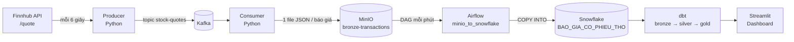

# Real-time Stock Pipeline

Pipeline dữ liệu chứng khoán gần thời gian thực theo kiến trúc **Modern Data Stack**: lấy báo giá cổ phiếu Mỹ từ Finnhub, truyền qua Kafka, lưu thô vào MinIO, nạp vào Snowflake bằng Airflow, biến đổi theo mô hình bronze → silver → gold bằng dbt và hiển thị trên dashboard Streamlit.

Mã theo dõi: `AAPL`, `MSFT`, `TSLA`, `GOOGL`, `AMZN`.

## Kiến trúc



| Thành phần | Công nghệ | Vai trò |
|---|---|---|
| Nguồn dữ liệu | [Finnhub](https://finnhub.io) `/quote` | Giá hiện tại, cao/thấp/mở cửa trong ngày, giá đóng cửa phiên trước |
| Streaming | Kafka + Zookeeper, Kafdrop | Hàng đợi báo giá giữa producer và consumer |
| Data lake | MinIO (S3-compatible) | Lưu mỗi báo giá thành một file JSON |
| Điều phối | Apache Airflow 2.9 | Mỗi phút tải file mới từ MinIO → Snowflake, rồi chuyển file sang `da_xu_ly/` |
| Kho dữ liệu | Snowflake | Bảng thô `BAO_GIA_CO_PHIEU_THO` (một cột `VARIANT`) |
| Biến đổi | dbt (dbt-snowflake) | Các view bronze / silver / gold |
| Hiển thị | Streamlit + Plotly | Dashboard tự làm mới |

## Các tầng dữ liệu (dbt)

| Tầng | Model | Nội dung |
|---|---|---|
| Bronze | `stg_data` | Tách JSON thành cột, đổi tên sang tiếng Việt, ép kiểu (giây Unix → timestamp) |
| Silver | `int_data` | Bỏ báo giá giá 0 và **bỏ trùng**: ngoài giờ giao dịch Finnhub trả về cùng một báo giá nhiều lần, chỉ giữ 1 dòng cho mỗi *(mã, thời điểm thị trường)* |
| Gold | `tong_quan_co_phieu` | Báo giá mới nhất của từng mã (hàng KPI) |
| Gold | `fct_treemaps` | Báo giá mới nhất cho treemap: kích thước = giá, màu = % so với phiên trước |
| Gold | `fct_candlesticks` | Nến giá theo ngày (12 phiên gần nhất mỗi mã) |

## Dashboard

- **Tổng quan:** giá hiện tại và mức tăng/giảm so với giá đóng cửa phiên trước của 5 mã.
- **Biểu đồ nến:** chọn mã để xem nến theo ngày, kèm bảng dữ liệu của mã đó.
- **Treemap:** ô càng to giá càng cao; xanh là tăng, đỏ là giảm, màu càng đậm thay đổi càng mạnh.
- Tự làm mới sau 10–120 giây (chỉnh ở thanh bên).

## Cấu trúc thư mục

```
├── producer/producer.py         # Finnhub → Kafka
├── consumer/consumer.py         # Kafka → MinIO
├── dags/minio_to_snowflake.py   # Airflow DAG: MinIO → Snowflake
├── dbt_stocks/
│   ├── dbt_project.yml
│   └── models/
│       ├── bronze/              # sources.yml, stg_data.sql
│       ├── silver/              # int_data.sql
│       └── gold/                # tong_quan_co_phieu, fct_treemaps, fct_candlesticks
├── dashboard/app.py             # Streamlit dashboard
├── docker-compose.yml           # Kafka, Zookeeper, Kafdrop, MinIO, Airflow, Postgres
├── requirements.txt
└── .env.example                 # Mẫu biến môi trường
```

## Cài đặt và chạy

### Yêu cầu
- Docker và Docker Compose
- Python 3.10+
- Tài khoản [Snowflake](https://signup.snowflake.com) (bản dùng thử miễn phí là đủ)
- API key miễn phí của [Finnhub](https://finnhub.io/register)

### 1. Cấu hình biến môi trường

```bash
cp .env.example .env
```

Điền API key Finnhub, mật khẩu MinIO và thông tin Snowflake vào `.env`. File này đã nằm trong `.gitignore`. Producer, consumer, DAG Airflow và dashboard đều đọc bí mật từ đây.

### 2. Tạo bảng thô trên Snowflake

```sql
CREATE DATABASE IF NOT EXISTS STOCK_MDS;
CREATE SCHEMA IF NOT EXISTS STOCK_MDS.COMMON;
CREATE TABLE IF NOT EXISTS STOCK_MDS.COMMON.BAO_GIA_CO_PHIEU_THO (du_lieu VARIANT);
```

### 3. Khởi động hạ tầng

```bash
pip install -r requirements.txt
docker compose up -d

# Lần đầu: khởi tạo database và tạo tài khoản Airflow
docker compose exec airflow-scheduler airflow db init
docker compose run airflow-webserver airflow db migrate
docker compose exec airflow-webserver airflow users create \
  --username <USER_NAME> --firstname <FIRST_NAME> --lastname <LAST_NAME> \
  --role Admin --email <EMAIL> --password <PASSWORD>
```

| Dịch vụ | Địa chỉ |
|---|---|
| Airflow | http://localhost:8080 |
| Kafdrop (xem Kafka) | http://localhost:9000 |
| MinIO Console | http://localhost:9001 |

### 4. Chạy producer và consumer

Mở hai terminal:

```bash
python producer/producer.py
python consumer/consumer.py
```

Sau đó bật DAG `minio_to_snowflake` trên giao diện Airflow.

### 5. Chạy dbt

Tạo `~/.dbt/profiles.yml`:

```yaml
dbt_stocks:
  target: dev
  outputs:
    dev:
      type: snowflake
      account: "{{ env_var('SNOWFLAKE_ACCOUNT') }}"
      user: "{{ env_var('SNOWFLAKE_USER') }}"
      password: "{{ env_var('SNOWFLAKE_PASSWORD') }}"
      role: ACCOUNTADMIN
      warehouse: COMPUTE_WH
      database: STOCK_MDS
      schema: COMMON
      threads: 4
```

Rồi chạy:

```bash
cd dbt_stocks
dbt run
```

Các model đều là view nên chỉ cần chạy lại `dbt run` khi sửa SQL. Dữ liệu mới tự xuất hiện khi truy vấn.

### 6. Mở dashboard

```bash
streamlit run dashboard/app.py
```

Dashboard mở tại http://localhost:8501.

## Lưu ý về dữ liệu Finnhub

- Sàn Mỹ giao dịch 9:30–16:00 giờ New York, tức **20:30–03:00 giờ Việt Nam** (giờ mùa hè) hoặc **21:30–04:00** (giờ mùa đông).
- Trong phiên, báo giá trễ khoảng 20–40 giây so với thời điểm gọi API.
- Ngoài phiên, API trả về mãi một báo giá của lúc đóng cửa. Producer vẫn chạy bình thường nhưng chỉ sinh dòng trùng, và tầng silver sẽ loại bỏ chúng.
- `muc_thay_doi` và `phan_tram_thay_doi` được tính so với **giá đóng cửa phiên trước** (thứ Hai so với thứ Sáu).
